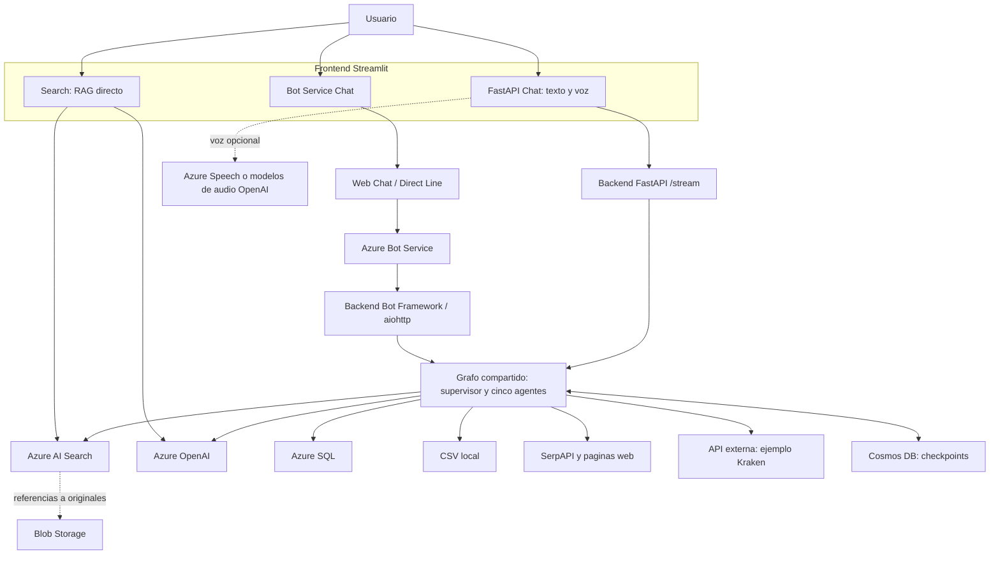
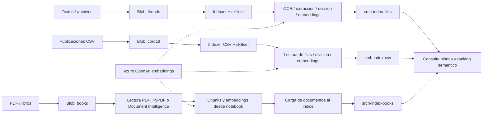
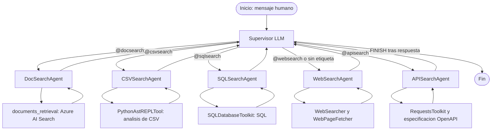
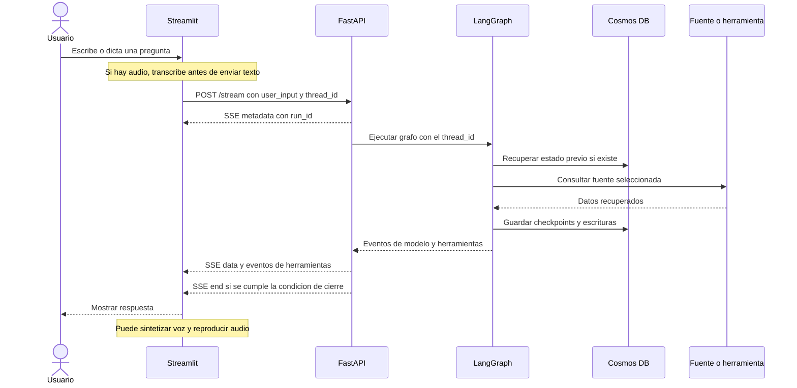
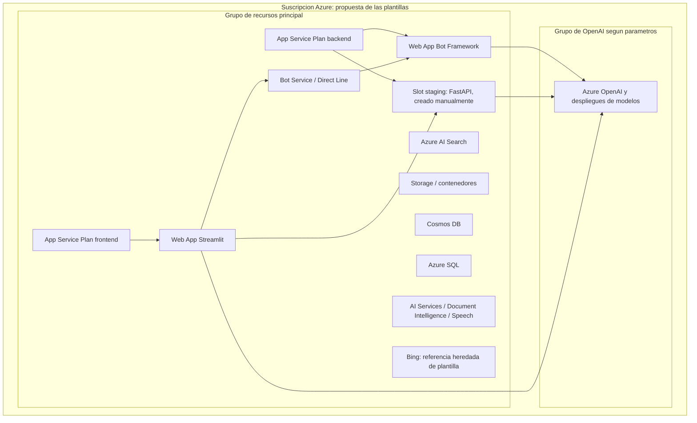

# 02 - Arquitectura y flujos dibujados

[Volver al índice](README.md)

> Los dibujos representan conexiones observadas en código y la intención de las plantillas. No son un inventario de recursos desplegados. Los bloqueos de integración están documentados en [Hallazgos](05-HALLAZGOS-Y-SIGUIENTES-PASOS.md).

## 1. Arquitectura lógica general



**Cómo leerlo:**

- Search constituye una ruta independiente del backend conversacional.
- Bot Framework y FastAPI son dos adaptadores del mismo núcleo, no dos sistemas de agentes distintos.
- Azure OpenAI no sustituye a las fuentes: ayuda a consultarlas y a redactar la respuesta.
- Cosmos DB almacena estado del grafo, no es el índice documental.
- El acceso web/API sale de Azure hacia servicios externos; no todo el flujo es privado por el hecho de usar Azure.
- La voz está implementada en la página de chat FastAPI. No se afirma que todos los canales tengan voz o visión.

Evidencia: [Search](../apps/frontend/app/pages/1_Search.py), [Web Chat](../apps/frontend/app/pages/2_BotService_Chat.py), [chat FastAPI](../apps/frontend/app/pages/3_FastAPI_Chat.py), [grafo](../common/graph.py).

## 2. Preparación e ingesta documental



Los [notebooks 01](../01-Load-Data-ACogSearch.ipynb) y [02](../02-LoadCSVOneToMany-ACogSearch.ipynb) construyen pipelines de Azure AI Search. El [notebook 04](../04-Complex-Docs.ipynb) muestra extracción y carga manual para documentos complejos.

Los tres índices se configuran en los notebooks con vectores de **3072 dimensiones**. Deben coincidir con las dimensiones reales del modelo de embeddings seleccionado. Cambiar de modelo no consiste solamente en renombrar una variable.

La ingesta y las preguntas son procesos distintos. Las APIs de conversación no crean automáticamente estos índices.

### Cómo recupera documentos una pregunta

En [get_search_results](../common/utils.py), cada índice recibe una petición que combina:

1. Texto de búsqueda.
2. Consulta vectorial basada en texto sobre `chunkVector`.
3. Ranking semántico con `my-semantic-config`.
4. Captions y respuestas extractivas.

La aplicación filtra por `@search.rerankerScore`, reúne resultados y conserva los mejores `k` globales. Los campos esperados son `id`, `title`, `chunk`, `name` y `location`.

La consulta vectorial `kind: text` depende de la vectorización configurada en el índice. La configuración semántica y el esquema deben existir previamente.

En el grafo, la búsqueda documental usa `k=20` y umbral `1.5`; la página Search usa `k=10` y umbral `1`. Las dos experiencias pueden devolver contextos distintos.

Según [Microsoft Learn](https://learn.microsoft.com/en-us/azure/search/hybrid-search-overview), Azure AI Search combina texto y vectores mediante RRF dentro de una búsqueda híbrida. La agregación entre varios índices que hace este repositorio es un paso adicional de la aplicación; no equivale a consultar un único índice global.

## 3. Supervisor y especialistas



Las etiquetas describen las instrucciones del [prompt](../common/prompts.py), no condiciones de código que analicen literalmente el texto del usuario.

En [graph.py](../common/graph.py), el modelo del supervisor se configura con el despliegue `GPT4o_DEPLOYMENT_NAME`, temperatura `0` y un máximo de `2000` tokens por respuesta del modelo. No es un presupuesto total del flujo: una pregunta puede generar varias llamadas a modelos y herramientas.

El nodo especializado añade su último mensaje al historial como un `AIMessage` con nombre de agente. Después vuelve al supervisor. El backend devuelve el contenido del último mensaje del resultado; no hay una capa independiente que garantice una síntesis final de todas las fuentes.

## 4. Una conversación vía FastAPI



Es una secuencia conceptual: los checkpoints se producen durante la ejecución, no únicamente al terminar. El detalle exacto de eventos depende de LangGraph y debe probarse con versiones de dependencias fijadas.

El frontend envía `session_id` como `thread_id`. También genera un `user_id`, pero el [helper HTTP](../apps/frontend/app/helpers/streamlit_helpers.py) no lo incluye en el cuerpo de la petición: lo usa en logs. No debe confundirse ese identificador visual con un esquema de identidad/autorización del backend.

Evidencia: [servidor](../apps/backend/fastapi/app/server.py), [helper SSE](../apps/frontend/app/helpers/streamlit_helpers.py), [checkpointer](../common/cosmosdb_checkpointer.py).

## 5. Topología de despliegue pretendida



Este dibujo distingue el **objetivo del despliegue** del estado real:

- Las plantillas de aplicación declaran dos App Service Plans y dos Web Apps.
- El [README de FastAPI](../apps/backend/fastapi/README.md) propone usar un slot `staging` del backend; no se encontró su creación en las plantillas Bicep revisadas.
- La plantilla del frontend construye una URL hacia ese slot.
- El [Bicep raíz](../azuredeploy.bicep) declara los servicios base; [infra/main.bicep](../infra/main.bicep) intenta orquestar OpenAI y aplicaciones.
- La presencia de Bing en infraestructura no describe la herramienta web compartida actual, que utiliza SerpAPI.
- No se dibujan redes privadas, observabilidad centralizada o un servicio de secretos como si ya estuvieran implementados.

## Resumen sin visor de diagramas

```text
Documentos -> Blob -> extraccion/chunks/embeddings -> AI Search

Usuario -> Search en Streamlit -> AI Search + OpenAI -> respuesta

Usuario -> Chat en Streamlit -> FastAPI o Bot Service
        -> supervisor -> agente -> fuente -> respuesta
                     <-> Cosmos DB para estado
```
